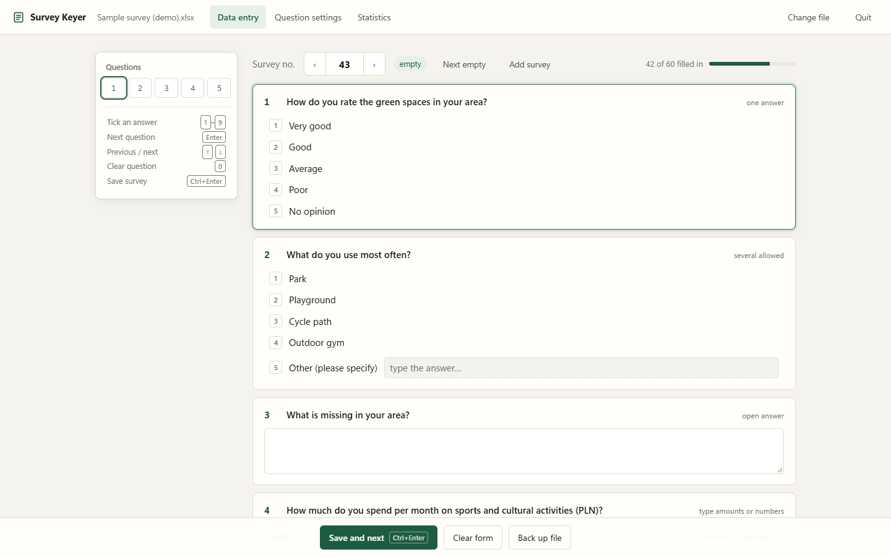
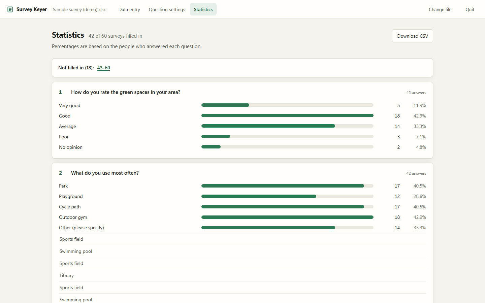
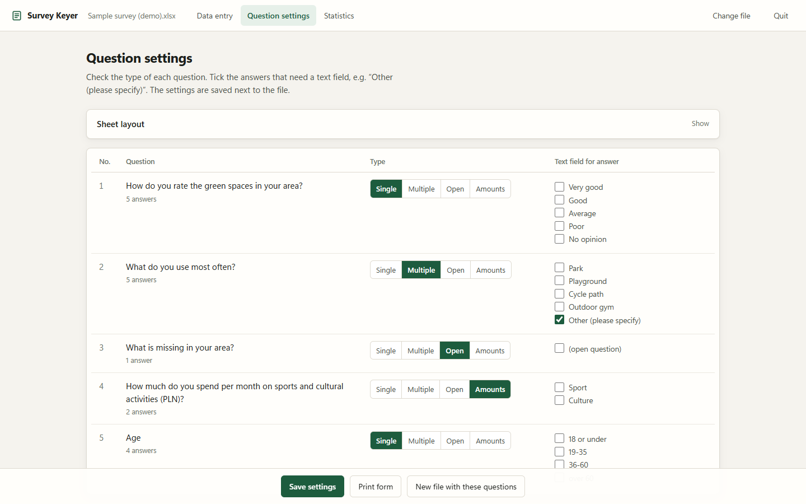

# Survey Keyer

Survey Keyer turns a stack of paper questionnaires into a filled-in Excel workbook. It reads the questions from a sheet laid out the way office surveys usually are (a question row, an answer row, a totals row, then one row per survey), shows a keyboard-driven form and writes each answer straight into the file. Only the answer cells change, so the workbook's charts, formulas and formatting stay intact.

It is built for people who type in hundreds of surveys per project and are not always comfortable with computers: everything works from the keyboard, and every error message says what to do next.

It was originally made for Polish office staff. This public version has an English interface and still reads existing Polish workbooks and Polish amount formats such as `1.500,50 zł`.



## Run in demo mode

Demo mode creates a sample residents' survey with made-up data and 42 filled-in answers, and opens it right away. You do not need any of the organisation's files.

You need Python 3.10+ (tested on 3.10 and 3.13) and a web browser.

```bash
python -m pip install -r requirements.txt
```

```bash
python survey_keyer.py --demo
```

The sample file, `Sample survey (demo).xlsx`, is created in the `Survey Keyer demo` folder in your home directory (instead of `--demo` you can set the environment variable `DEMO=true`). You can open your own file with `python survey_keyer.py "survey.xlsx"` or with the "Change file" button. On Windows, `SurveyKeyer.bat` starts the program with a double-click.

## Screenshots

| | |
|---|---|
|  |  |
| **Statistics:** number and percentage of answers, sums of amounts, export | **Question settings:** question type and a text field for the "Other" answer |

## Features

- **Reads any survey in this layout.** The program detects the sheet layout by itself, and you can correct it in the settings. Question types: single choice, multiple choice, open question, amounts.
- **Fast keyboard entry.** Digits 1–9 tick an answer, Enter and the arrow keys move between questions, and Ctrl+Enter saves the survey and moves on to the next one.
- **Safe saving.** The program replaces only the answer cells in the `.xlsx` file (atomic write). Before the first save in a session it copies the file to the `backups` subfolder, it warns you when the file is open in Excel, and when the numbered rows run out it adds new rows with the formatting of the previous ones.
- **Live statistics** with export; the exported data is protected against formula injection.
- **New survey wizard:** you type in the questions and answers and get a ready Excel file in this layout (with a totals row and a charts sheet), plus a form to print.

## Security

The program runs as a local server with a single page in the browser.

- **Only this tab.** The server listens on `127.0.0.1`, checks the `Host` and `Origin` headers (protection against DNS rebinding and against forms on other websites) and requires a random token in a header of every API request. The page sends a CSP policy with a one-time nonce for its script.
- **The token is not part of the page.** Any program on the computer could fetch the page, including one running under another user's account, so the page does not contain the key. The app opens the tab with the key in the URL (`?t=`), and the tab moves it to session storage and clears the URL. The token itself is kept in a settings file in the user's home directory, outside the project.
- **A second copy of the program does not give the key away.** Before it hands a file over to the running app, it verifies the app with an HMAC challenge tied to the port number. A program that took over port 8765 gets neither the key nor the file path.
- **Careful with outside files.** The workbook's unpacked size is checked before it is loaded into memory (zip bomb). XML from the file is read with `defusedxml`, which rejects DTD declarations and entities (XXE, "billion laughs"). Survey answers, and the title and answer options from the wizard, are saved as text, never as a formula. The CSV export is protected against formula injection. A new file is saved only where the user chose in the "Save as" dialog.

## How it is built

One file, `survey_keyer.py`: the Python standard library (`http.server`, `zipfile`) plus `openpyxl` for creating new files and `defusedxml` for reading the workbook's XML safely. The interface is a single HTML/CSS/JS page embedded in the program. Answers go into the file through direct edits of the sheet's XML, which is why charts and formulas survive saving.

## Tests

```bash
python -m unittest test_survey_keyer -v
```

20 tests check amount parsing (Polish and English formats), cell XML validity, saving and loading answers, statistics and the CSV export, adding rows with formatting, changes made to the file from outside, layout detection with English and Polish sheet headers, demo mode, and the safeguards: no key in the page, rejecting an impostor server, zip bombs, entities in XML and formulas in the wizard.

## .exe build

For distribution, the program is packaged with PyInstaller into a single `SurveyKeyer.exe` file with the `survey_keyer.ico` icon:

```bash
python -m pip install pyinstaller
```

```bash
python -m PyInstaller --onefile --windowed --icon survey_keyer.ico --name SurveyKeyer survey_keyer.py
```

## License

MIT, see [LICENSE](LICENSE).
